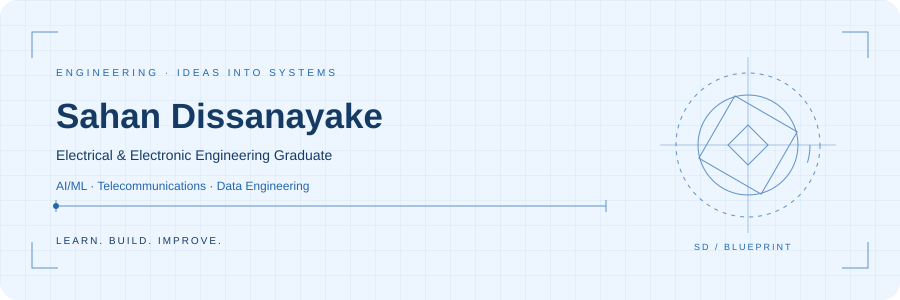

# Hi, I'm Sahan Dissanayake 👋

**Engineering Graduate · AI/ML · Telecommunications · Data Engineering**

I’m a recent Electrical and Electronic Engineering graduate from the **University of Peradeniya, Sri Lanka**, interested in turning data and engineering ideas into practical systems.

## About me

- 🎓 BSc (Hons) in Electrical and Electronic Engineering, University of Peradeniya.
- 📡 Completed a **Network Analytics and Automation internship at Dialog Axiata**, working with telecommunications data, Big data analytics and Machine Learning.
- 🧠 My project experience spans deep learning, language-model fine-tuning, biomedical signals, and AI-powered applications.
- 🌱 Interested in growing as an engineer across **AI/ML, telecommunications, and data engineering**.

<picture>
  <source media="(prefers-color-scheme: dark)" srcset="https://raw.githubusercontent.com/sahan24854/sahan24854/main/assets/blueprint-dark.svg" />
  <source media="(prefers-color-scheme: light)" srcset="https://raw.githubusercontent.com/sahan24854/sahan24854/main/assets/blueprint.svg" />
  
</picture>

## Technical toolkit

  
  &nbsp;&nbsp;
  
  &nbsp;&nbsp;
  
  &nbsp;&nbsp;
  
  &nbsp;&nbsp;
  
  &nbsp;&nbsp;
  
  &nbsp;&nbsp;
  

| Area | Tools and experience |
| :--- | :--- |
| **Programming** | Python · SQL · TypeScript |
| **AI / ML** | PyTorch · TensorFlow / Keras · scikit-learn · Hugging Face Transformers · PEFT / LoRA |
| **Data & cloud** | PySpark · Microsoft Fabric · Azure ML · Pandas · NumPy |
| **Telecommunications & geospatial** | RAN analytics · Coverage analysis · PostgreSQL / PostGIS · QGIS |
| **Applications & development** | React · Supabase · Git / GitHub · Docker |

## Let's connect

  
  
  
  

Curious about the work behind the tools? Explore my portfolio for project details and results.

